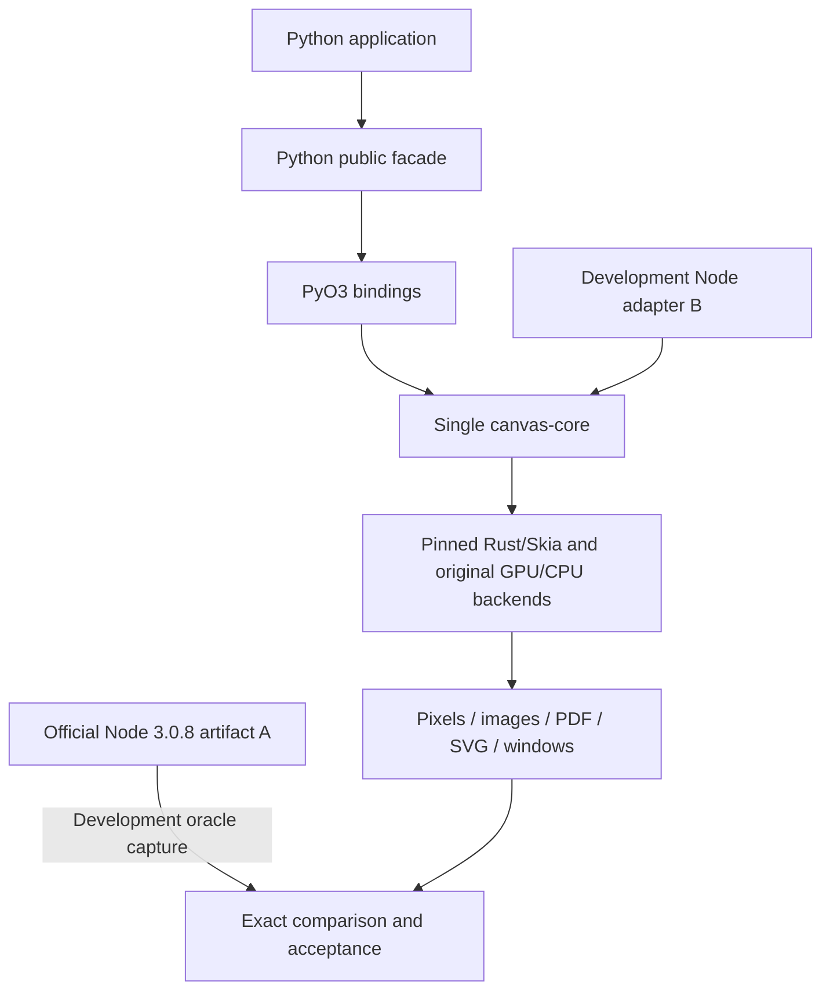

# Development guide: modify py-skia-canvas

[中文](README.md) | English

For AI modifying Python/Rust bindings, diagnosing compatibility, building wheels, or maintaining releases. To build an application with Canvas, start with the [usage guide](../usage/README.en.md).

## 1. Required reading

First read root [AGENTS.md](../../../AGENTS.md) and its required [NEW_SESSION](../../NEW_SESSION.md), [IMPLEMENTATION_PLAN](../../IMPLEMENTATION_PLAN.md), [API_COMPATIBILITY](../../API_COMPATIBILITY.md), and [TASKS](../../TASKS.md) in full. Then read:

1. [RELEASE_STATUS](../../RELEASE_STATUS.md): artifacts, provenance, hashes, and actual installation checks.
2. [COMPLETION_REPORT](../../COMPLETION_REPORT.md), [PYTHON_HOST_PROFILE](../../PYTHON_HOST_PROFILE.md), [alpha-api-status.json](../../alpha-api-status.json): migrated scope, host differences, and per-item status.
3. [CPU_RENDER_REPORT](../../CPU_RENDER_REPORT.md): GPU-less/Vulkan-less offscreen acceptance and retained window/vector-sequence limitations.
4. This directory's [workflow](WORKFLOW.en.md) and [testing/release guide](TESTING_AND_RELEASE.en.md), followed by the target modules and tests.

The baseline release as of 2026-10-29 is **0.1.0a18**, published to PyPI, TestPyPI, and GitHub Release. Early plans/test introductions and some docstrings still mention pending migration or unpublished artifacts. They do not override current evidence. Do not redo completed work solely because of historical wording. New code requires new evidence; an old accepted wheel does not validate a patch.

Authoritative project instructions and historical reports remain in Chinese. These English guides provide the current workflow and constraints; they do not alter those original records.

## 2. Goal and boundaries

This is a general-purpose Canvas library: graphics, text, images, pixels, effects, pages, exports, and windows. Compatibility targets official **Node skia-canvas 3.0.8**, source commit `042312a3f40b660b1d7dc0beba541486171bc5cc`.

Preserve original Rust/Skia font selection, shaping, layout, drawing, compositing, caching, encoding, and Vulkan policy. Python supplies language bindings and accepted host-type mappings. Do not introduce another renderer, pixel compensation, font substitutions, tolerances, or default CPU behavior to conceal differences.



Official Node A is a development oracle, never a Python runtime dependency. Node B still shares the same core. The user explicitly requires daily Python comparisons against official A, **without rebuilding Node for each batch**. Build/check adapter B when that adapter or its build chain changes, and label it as a development candidate.

## 3. Repository map

| Path | Responsibility | Editing rules |
| --- | --- | --- |
| [python/py_skia_canvas](../../../python/py_skia_canvas) | Public objects, arguments/strings/host values, awaitables, events | No duplicate rendering/layout policy; aliases forward to one implementation |
| [crates/python](../../../crates/python) | PyO3, owner TLS, Python/core conversion | Preserve ownership/lifetimes; callbacks/conversion must not retain unsafe native borrows |
| [crates/canvas-core](../../../crates/canvas-core) | Single Rust drawing core | Mechanically separate language bindings; retain unchanged logic, no temporary stubs |
| [crates/node](../../../crates/node) | Development Node adapter B | Consumes the same core; excluded from production wheels |
| [crates/skia-bindings](../../../crates/skia-bindings) | Pinned Skia build/static Fontconfig patch | Controlled provenance/licenses; no incidental upgrades |
| [crates/source-map.json](../../../crates/source-map.json) | Mapping original files/functions to the working copy | Record extractions/renames and permitted mechanical changes |
| [references](../../../references) | Source snapshots/fingerprints | `references/upstream` is read-only; not a runtime crate/fallback |
| [tests/fixtures](../../../tests/fixtures) | Shared Node/Python inputs | Test protocol only, not a production drawing language |
| [tests/oracle](../../../tests/oracle) | Pinned official A capture | Explicit module/version/native SHA; no substitute version |
| [tests/python](../../../tests/python), [tests/cpu](../../../tests/cpu) | Lifecycle, threads, async, GUI, CPU checks | Run relevant scope; missing resources mean unaccepted coverage |
| [scripts](../../../scripts) | Provenance, capture, comparison, traces, builds/artifacts | Do not inflate tool status into release acceptance |
| `test-runs/<run-id>/` | Fresh evidence/output | New directories; never overwrite; local resources/binaries normally uncommitted |
| [docs](../..) | Contracts, historical reports, current status | Separate plans, execution, results, and limitations |

## 4. Turn a request into a completed batch

Identify the trigger, actual behavior, official A behavior, and intended outcome. Decide whether the issue belongs to a binding, host mapping, or original core. Deliver one substantial goal with code, source mapping, tests, and limitations, rather than empty entry points.

Typical deliverables:

- Reproducible input/fixture and original pre-change results from Node A/current wheel.
- Minimal source-mapped patch. Every new/migrated function documents purpose, parameters, units, return, exceptions, thread/ownership constraints, and upstream location.
- Newly built candidate wheel with its fixed SHA, used for post-change checks.
- Relevant independent assertions and Node A comparisons, plus actual GPU/font/async observations where affected.
- Accurate report of passed checks, unexecuted areas, platforms/backends, and accepted upstream limitations.

For documentation/demo-only changes, state that production behavior did not change and validate links/code/example usage. Rebuilding Skia is unnecessary. For library code changes, the published wheel is only a pre-change reference, never validation of the new source.

## 5. Boundaries AI must preserve

Canvas, Context, Path, Image, styles, and GPU contexts retain their creation-thread constraints. Do not add unproven `unsafe impl Send/Sync` or hand existing Canvas objects to Python thread pools. Parallel demos create/draw/export inside each worker and return bytes.

Missing GPU/fonts/drivers means missing corresponding acceptance. Successful CPU fallback cannot replace default GPU acceptance. GUI requires GPU/desktop support; CPU acceptance covers offscreen work and exports. The user accepted the upstream nondeterministic Windows parallel PDF/SVG sequence limitation; record it and distinguish explicit serial diagnostics from defaults.

Preserve user changes. Prior publication authorization does not automatically cover a new task's commit/push/release; follow current-task authorization. Complete read-only investigation, local fixes, builds, and reviewable artifacts within scope. Do not create placeholder PyPI projects or upload unaccepted artifacts.

## 6. Development task prompt

```text
Task: fix/migrate <specific public behavior>.
Read the AGENTS.md prerequisites and docs/ai/development/README.en.md first.
Record git status and preserve existing changes. Target official skia-canvas@3.0.8.
Build a minimal reproduction using the pattern in examples/development/parity-smoke.json;
preserve pre-change evidence. Locate read-only upstream provenance and the single core/binding.
Do not rewrite font/drawing/GPU policy or hide JSON/pixel differences.
Build a new candidate wheel; use those exact bytes for relevant normal/STRICT, GPU,
lifecycle, and required CPU checks. Use new test-runs directories.
Deliver changes, provenance, commands, results, actual limitations, and next steps.
Follow current-task authorization for external synchronization/publication.
```

Continue with the executable [workflow](WORKFLOW.en.md). Interpret final statuses through [testing and release](TESTING_AND_RELEASE.en.md).
