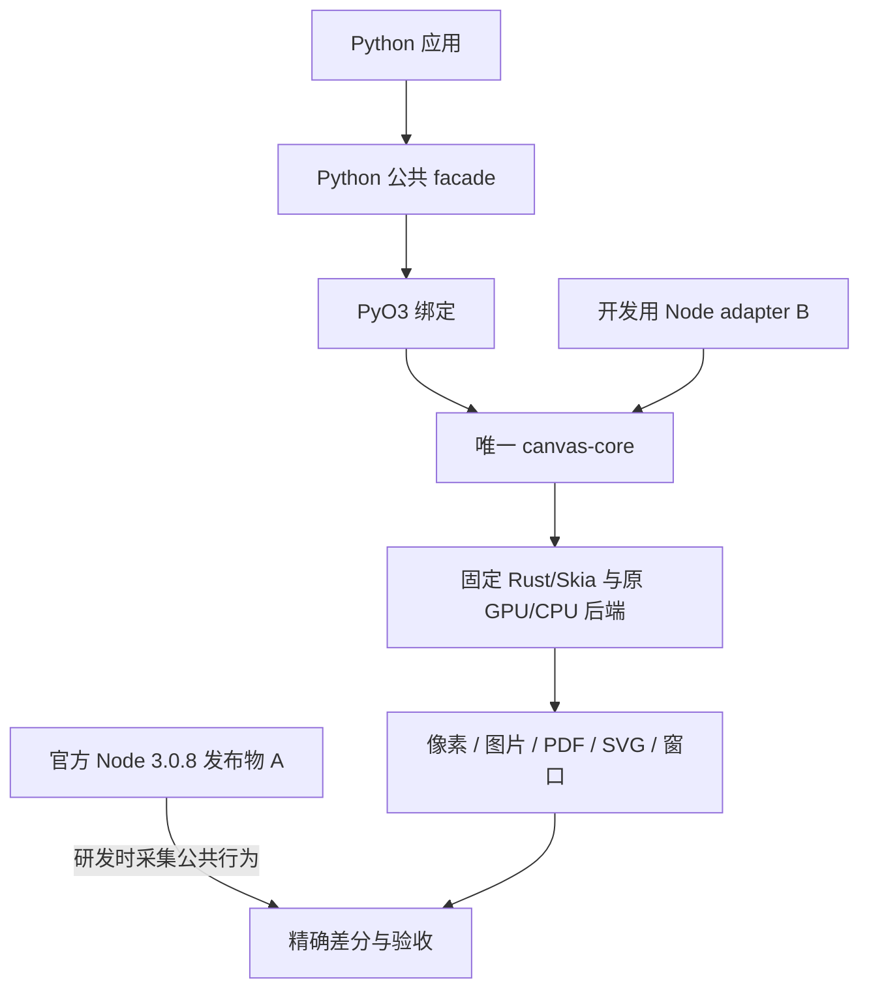

# 开发指南：修改 py-skia-canvas 库

本目录面向修改 Python/Rust 绑定、诊断兼容问题、构建 wheel 和维护发布流程的 AI。只想用 Canvas 开发应用时，从[使用指南](../usage/README.md)开始。

## 1. 开始前读什么

先完整读取根 [AGENTS.md](../../../AGENTS.md) 及其指定的 [NEW_SESSION](../../NEW_SESSION.md)、[IMPLEMENTATION_PLAN](../../IMPLEMENTATION_PLAN.md)、[API_COMPATIBILITY](../../API_COMPATIBILITY.md)、[TASKS](../../TASKS.md)。随后读取：

1. [RELEASE_STATUS](../../RELEASE_STATUS.md)：当前发布物、来源、SHA、实际安装回验。
2. [COMPLETION_REPORT](../../COMPLETION_REPORT.md)、[PYTHON_HOST_PROFILE](../../PYTHON_HOST_PROFILE.md)、[alpha-api-status.json](../../alpha-api-status.json)：当前迁移范围、宿主差异和逐项状态。
3. [CPU_RENDER_REPORT](../../CPU_RENDER_REPORT.md)：无 GPU/无 Vulkan 的离屏验收，及保留的窗口和矢量序列限制。
4. 本目录的[开发流程](WORKFLOW.md)与[测试、发布流程](TESTING_AND_RELEASE.md)，再读目标模块及对应测试。

2026-10-29 的基准发行版是 **0.1.0a18**，已发布到正式 PyPI、TestPyPI 和 GitHub Release。上述资料中的早期计划、旧测试简介及个别 docstring 仍可能出现“待迁移/未发布”。这些历史描述不覆盖最新发行证据；不要仅凭旧文字重做已经完成的迁移。新代码变更必须有自己的新证据，旧 wheel 通过不等于新补丁通过。

## 2. 项目目标和边界

这是通用 Canvas 库：图形、文本、图片、像素、效果、多页、导出和窗口。兼容目标固定为官方 **Node skia-canvas 3.0.8** 公共行为，对应源码 commit `042312a3f40b660b1d7dc0beba541486171bc5cc`。

保留原 Rust/Skia 的字体选择、shaping、布局、绘制、混色、缓存、编码和 Vulkan 策略。Python 做语言绑定及已批准的宿主类型对应。不能引入另一套绘图实现来“补齐”结果，也不能用像素补偿、字体替换、容差或默认 CPU 掩盖差异。



官方 Node A 是开发对照工具，Python 运行时不调用它。Node B 消费同一 core 的架构仍保留；用户已明确日常验收只要求 Python 对照官方 A，**不用每批重编 Node**。只有实际修改 adapter B 或对应构建链时，才做相应编译/检查，并标记为开发候选。

## 3. 仓库导航

| 路径 | 职责 | 修改规则 |
| --- | --- | --- |
| [python/py_skia_canvas](../../../python/py_skia_canvas) | 公共对象、参数/字符串/宿主值转换、awaitable、事件 | 不实现第二份绘制/布局策略；别名转发同一入口 |
| [crates/python](../../../crates/python) | PyO3 绑定、owner TLS、Python 与 core 之间的转换 | 保持 owner/lifetime 边界；回调及转换不得持有不安全原生借用 |
| [crates/canvas-core](../../../crates/canvas-core) | 唯一 Rust 绘图核心 | 机械分离绑定；保留未改逻辑，不以临时 stub 替换 |
| [crates/node](../../../crates/node) | 开发用 Node adapter B | 共同消费唯一 core；不进入生产 wheel |
| [crates/skia-bindings](../../../crates/skia-bindings) | 固定版本 Skia 构建、静态 Fontconfig 补丁 | 保留受控来源与许可证，不能随意升级 |
| [crates/source-map.json](../../../crates/source-map.json) | 原文件/函数与当前唯一工作副本的来源映射 | 提取/改名时记录映射和允许的机械变换 |
| [references](../../../references) | 来源快照及指纹 | `references/upstream` 只读；不作为独立运行时 crate/fallback |
| [tests/fixtures](../../../tests/fixtures) | Node/Python 共用测试输入 | 协议仅测试使用；不是生产绘图语言 |
| [tests/oracle](../../../tests/oracle) | 固定官方 A 的采集器 | 明确模块路径/版本/native SHA；不得加载另一版替代 |
| [tests/python](../../../tests/python)、[tests/cpu](../../../tests/cpu) | 生命周期、线程、异步、窗口、CPU 专项 | 按影响范围运行；缺资源记录未验收 |
| [scripts](../../../scripts) | 来源校验、捕获、比较、trace、构建和发布物工具 | 工具状态不得夸大为发布验收 |
| `test-runs/<run-id>/` | 新证据和输出 | 每次新目录，禁止覆盖；默认不提交二进制/本机资源 |
| [docs](../..) | 契约、历史报告、当前状态 | 区分计划、实际执行、结果和限制 |

## 4. 把一个请求变成可交付批次

先说明触发条件、当前实际行为、官方 A 行为和期望结果；再确定是语言绑定、宿主类型还是原 core 问题。一个大目标完成后交付相关代码、来源、测试与限制，不能只交空入口。

推荐每批产出：

- 一个可复现的输入/fixture，修改前 Node A 与当前 wheel 的原始结果。
- 一份有来源映射的最小修改；每个新增/迁移函数注明功能、参数、单位、返回、异常、线程/所有权和上游位置。
- 新构建的候选 wheel 及其固定 SHA；用该 wheel 完成修改后检查。
- 影响范围内的独立断言和 Node A 差分；涉及 GPU/字体/异步时增加对应原生证据。
- 准确的报告：通过项、未执行项、实际平台/后端、已接受的上游限制。

若仅改文档/示例，说明没有生产行为改动，运行文档链接/代码语法检查以及示例即可；不要为此无意义地重编 Skia。若修改了库代码，已发布 wheel 只能作修改前对照，不能代表新代码。

## 5. AI 操作中容易越界的地方

Canvas、Context、Path、Image、样式和 GPU context 保留创建线程约束。不能给线程局部对象添加未经证明的 `unsafe impl Send/Sync`，不能把已有 Canvas 塞进 Python 线程池。并行 demo 的正确做法是各 worker 自建/绘制/导出，返回 bytes。

缺 GPU、字体或驱动意味着缺少对应验收；自动回退 CPU 的成功也不能代替默认 GPU 验收。窗口需要 GPU/桌面，CPU 需求只验收离屏和导出。Windows 并发 PDF/SVG 文件序列的非确定性是用户已接受的上游限制，应记录；明确串行设置须与默认行为分开。

保持用户已有修改。旧会话的发布授权不自动覆盖新任务的 commit/push/发布；按当前任务授权处理。只读检查、局部修复、构建和准备可审查结果可继续完成；不要先创建占位 PyPI 项目或上传未验收产物。

## 6. 可直接交给 AI 的开发任务模板

```text
任务：修复/迁移 <明确公共行为>。
先读 AGENTS.md 指定资料和 docs/ai/development/README.md。
记录 git 状态，保留已有修改。兼容目标固定官方 skia-canvas@3.0.8。
用 examples/development/parity-smoke.json 的方式建立最小复现，保留修改前证据。
定位只读上游来源和唯一 core/Python 绑定位置，再修改对应边界。
禁止重写字体/绘图/GPU 策略，禁止隐藏像素/JSON 差异。
构建新候选 wheel，用同一字节做相关普通/STRICT、GPU、生命周期和必要 CPU 验证。
每次使用新 test-runs 目录。交付改动、来源、命令、结果、实际限制和下一步。
外部同步/发布按本次任务已有授权执行。
```

接着使用 [WORKFLOW](WORKFLOW.md) 的可执行步骤；最终状态按 [TESTING_AND_RELEASE](TESTING_AND_RELEASE.md) 区分。
