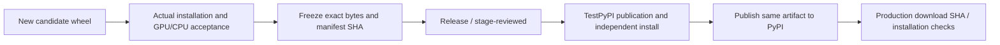

# Testing, evidence, and release acceptance

[中文](TESTING_AND_RELEASE.md) | English

Choose validation according to impact. Documentation/demo edits need no production-wheel rebuild; library code edits require a new candidate wheel. Compare against pinned official Node A 3.0.8 on the same platform, resources, backend, and mode.

## 1. What each successful status proves

| Level/status | Establishes | Does not establish |
| --- | --- | --- |
| `BOOTSTRAP_VALIDATED`, source/dependency checks | Documentation, protocol, inventories, controlled extraction, forbidden-dependency rules | Actual Python drawing, GPU, or release acceptance |
| `ORACLE_CAPTURED` | Official Node A captured inputs, outputs, and environment | Python implementation or equivalence |
| `CANDIDATE_CAPTURED` | A specified real Python wheel/development candidate executed capture | Equivalence to A or all APIs passing |
| `MATCHED_RECORDS` | Exact JSON, RGBA, decoded-PNG agreement for two scoped records | Complete API, actual font provenance, native GPU, GUI, or release certification |
| Lifecycle/native observations/visual review | Their respective ownership, actual drawing path, glyph provenance, appearance scope | Uncovered areas |
| Local wheel acceptance | A specified SHA passed requirements in specified environments | Actions, Release, or package-index publication |
| Actions / Release / TestPyPI / PyPI | Actual state of that external step | Automatic completion or byte identity of other steps |

Demo `EXAMPLES_COMPLETED` and documentation `AI_DOCS_STRUCTURALLY_VALIDATED` are scoped results, not whole-library compatibility verdicts. Interpret labels alongside commands, files, scope, and actual environments.

## 2. Validation by change type

| Change | Minimum relevant evidence |
| --- | --- |
| Documentation/application demo | Local links/code syntax, correct public entries, execution with installed wheel; actual platforms/backends |
| Argument or host mapping | Pre/post-change A comparisons, normal/STRICT, returns/exception order/side effects, reentrant callbacks |
| Paths/styles/effects/compositing | Exact GPU JSON/RGBA/PNG, including zero-alpha RGB; shared styles and save/restore assertions |
| Text/fonts | Identical font/config bytes; actual drawn glyph/face/fallback provenance; measurement/drawing, CJK/RTL/emoji, visual review where needed |
| Images/pixels | Encoded/raw distinction, formats/channels/color space, crop/smoothing, lifetimes, failures |
| Pages/exports/async | Formats, page/density/metadata, call-time snapshots, repeated await/cancellation, GC/owner cleanup, actual PDF/SVG contents |
| Threads/GPU/context | Owner errors, per-thread construction/destruction, actual Vulkan surface/submission traces, no unsafe Send/Sync |
| GUI/events | Main-thread real GPU window/pixels, input/close/error/restart; no-display environments cannot count as passes |
| CPU/deployment/artifacts | Automatic CPU fallback, explicit CPU, no Vulkan library, isolated installs/no Node or workspace dependencies, licenses/fixed bytes |

Complete relevant checks first. Broaden only when impact, failures, or unresolved questions justify it; documentation changes do not warrant rerunning thousands of unrelated rendering scenes.

## 3. Exact comparison rules

Preserve input SHA, implementation/native version/hash, wheel SHA, system/architecture, font/config manifest, requested/actual backend, JSON observations, RGBA, encoded outputs, and decoded results. Do not infer binding errors by comparing different OS system-font output.

JSON numbers and RGBA have **zero tolerance**. Booleans are not numbers. Count RGB differences even when alpha is zero. No resizing, cropping, early rounding, color compensation, or ignoring transparent RGB to force agreement. Equal PNG bytes are useful but do not replace pixel/dimension/metadata checks; different encoded bytes do not excuse skipping decoded-pixel comparison.

Inspect every PDF page and its content/structure, plus SVG structure/rasterization. Text width or FontLibrary.has does not establish glyph availability. `engine.renderer="GPU"` does not replace native-call/submission evidence.

See [tests/README](../../../tests/README.md) and the [workflow](WORKFLOW.en.md). Historical counts remain in reports; use actual runs and current-task scope.

## 4. Lifecycle, fonts, and actual backends

Run the installed environment from outside the repository, using an absolute interpreter path, empty child-process PATH, and `-I`. Independent assertion entry points:

```text
<installed-python> -I -m unittest discover -s <ABS_REPO>/tests/python -v
<installed-python> -I -m unittest discover -s <ABS_REPO>/tests/cpu -v
```

GPU/GUI suites need a real usable backend/desktop. Configure the CPU child process as its README specifies. Full 0.1.0a18 independent suites contain 118 and 23 tests respectively; report actual counts if tests change.

Font tools such as `audit_draw_sources.py` record actual drawn glyphs/faces/files/identities, distinguishing layout/measurement from paint. Linux `trace_python_gpu.py` uses GDB on the installed wheel to observe native paths. Diagnostics must not change font/layout/device choices.

Native Canvas-related objects remain owner-only. Verify GC, parent Canvas lifetime, async snapshots, cancellation, and thread exit independently. Thread tests must not transfer existing GPU contexts into a Python executor.

## 5. CPU is a separate deployment capability

As confirmed by the user, all offscreen Canvas tasks and exports have been accepted with the original CPU Raster path when GPU/Vulkan is unavailable. App/Window presentation retains its original GPU requirement.

For relevant future changes, distinguish:

1. Normal default behavior with usable GPU and confirmed actual GPU rendering.
2. Default Canvas CPU fallback with every Vulkan driver blocked in the child process, including CPU comparisons against A.
3. Explicit `canvas.gpu=False` diagnostics; constructor false is not a substitute.
4. A genuinely isolated environment without Vulkan loader/devices/Node. Driver blocking and llvmpipe Vulkan do not qualify as this environment.

[CPU suite documentation](../../../tests/cpu/README.md) defines matrix configuration, exports, and deployment probes. Use `probe_cpu_runtime.py --no-loader` only without an actual loader. Full 0.1.0a18 results are in [CPU_RENDER_REPORT](../../CPU_RENDER_REPORT.md); do not fabricate a new full acceptance run for documentation edits.

Windows default parallel PDF/SVG file-sequence glyph loss was reproduced in official A itself; the user accepted preserving and recording that limitation. Record explicit `RAYON_NUM_THREADS=1` exact results separately rather than presenting them as defect-free default parallel behavior.

## 6. Fresh evidence and licenses

Write every run to a new `test-runs/<run-id>/`; capture/comparison tools reject overwrites. Keep failures and use new runs after fixes, rather than rewriting failed reports. Reports identify actual commands, exit status, raw attachments, and hashes.

Normally commit reproducible fixtures/tools/report summaries only. Treat third-party licenses, system-font rights, and user-asset authorization separately. Do not commit system fonts, local node_modules, user files, credentials, or assets with unknown licenses. Font manifests record paths/fingerprints without copying font files.

Wheels contain complete licenses and no Node, Neon/N-API, source snapshots, old Codex packages, skia-python, other-workspace, or `.local` runtime dependencies. Check Windows PE imports, Linux dynamic dependencies, and external-directory installation/execution. Build/extract/actually compile sdists through `build_sdist.py` separately; new source-built wheels do not replace accepted wheel bytes.

## 7. Candidate to production index

Detailed rules are in [RELEASE_WORKFLOW](../../RELEASE_WORKFLOW.md). For each new version:

1. Pin version/source. Coordinate `pyproject.toml`, Python `__version__`, Python crate version, and lockfile. Published 0.1.0a18 cannot be replaced.
2. Build a candidate. `build-wheels.yml` produces **unreviewed** artifacts. Successful CI does not prove GPU/fonts/windows.
3. Accept the actual candidate wheel on both platforms as required: GPU/CPU, lifecycle, fonts, GUI, deployment, and licenses. Do not mark unmet requirements ACCEPTED.
4. Freeze exact wheel bytes/hashes/sizes, source provenance, and evidence; create `release-manifest.json` / `reviewed-wheels.zip`. Run `verify_release_bundle.py` with an externally supplied reviewed manifest SHA. This prevents wrong-artifact uploads, not inadequate evidence review.
5. Within current-task external authorization, synchronize source/tag/GitHub Release and upload the exact reviewed archive. Prepare concrete reviewable artifacts before any required approval; no placeholder packages.
6. Run `stage-reviewed.yml` from main with `release_tag`, `bundle_sha256`, `manifest_sha256`. It downloads/verifies and produces `reviewed-wheels`, **without rebuilding**.
7. Run `publish-reviewed.yml` from main with the stage run id as `candidate_run`, the same `manifest_sha256`, and first `destination=testpypi`.
8. Independently download from TestPyPI, verify the same SHA, install in isolation, and complete required checks. Then publish the same artifact to `destination=pypi`.
9. Independently download from production PyPI, verify SHA/size against local acceptance, reinstall/recheck. Verify GitHub Release downloads separately too.
10. Update RELEASE_STATUS with actual Actions/Release/TestPyPI/PyPI states and evidence. Never infer one step's success from another.



## 8. GitHub and PyPI configuration troubleshooting

The existing chain uses repository `xuanhun/py-skia-canvas`, workflow filename **`publish-reviewed.yml`**, and environments **`testpypi`** / **`pypi`**. Staging uses **`release-review`**. Workflow filename and environment must match OIDC configuration exactly. Review publisher settings if the repository/workflow changes.

GitHub login establishes GitHub access, not PyPI trust. Trusted Publishers are configured independently on each index. Account-level Pending Publishers are only for initial project creation; after creation, manage the normal publisher in that project's Publishing settings. For `invalid-publisher`, compare owner/repository/workflow/environment with the actual workflow identity. Rebuilding wheels or changing package-name characters does not fix the identity mismatch.

Use index account/project management pages where needed. Do not request or record API tokens, recovery codes, or credentials in chat, source, or logs. Current-task authorization persists; ask users only to complete genuinely missing account actions, without requesting already granted approval again.
