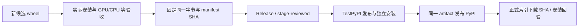

# 测试、证据与发布验收

中文 | [English](TESTING_AND_RELEASE.en.md)

按改动影响范围选择验证。文档/示例修改无需重建生产 wheel；改库代码后必须用新候选 wheel 验证。兼容目标固定为官方 Node A 3.0.8；比较同平台、同资源、同 backend 和同模式的结果。

## 1. 先明确每种“通过”说明什么

| 层次/状态 | 已证明 | 尚不能据此声称 |
| --- | --- | --- |
| `BOOTSTRAP_VALIDATED`、来源/依赖检查 | 文档、协议、索引、受控提取和禁止依赖规则满足检查 | Python 实际绘制、GPU 或发布通过 |
| `ORACLE_CAPTURED` | 官方 Node A 已采集输入、输出和环境 | Python 已实现或匹配 |
| `CANDIDATE_CAPTURED` | 指定真实 Python wheel/开发候选已执行采集 | 与官方一致、所有 API 通过 |
| `MATCHED_RECORDS` | 两份指定记录的 JSON、RGBA、解码 PNG 在限定范围精确一致 | 全 API、字体实际来源、native GPU、GUI 和发布认证 |
| 生命周期/原生观测/视觉审阅 | 各自范围内的所有权、实际绘制路径、字形来源、外观 | 其他未覆盖范围 |
| 本地 wheel 验收 | 指定 SHA 的 wheel 在指定环境完成全部要求 | Actions、Release、包索引实际已发布 |
| Actions / Release / TestPyPI / PyPI | 对应外部步骤的实际状态 | 其他步骤自动完成或下载内容必然相同 |

教程示例的 `EXAMPLES_COMPLETED`、文档结构检查的 `AI_DOCS_STRUCTURALLY_VALIDATED` 都是专项结果，不能写成全量兼容通过。状态标签须连同范围、命令、文件和实际运行环境解读。

## 2. 修改类型与验证范围

| 修改 | 至少需要的相关证据 |
| --- | --- |
| 文档/应用 demo | 本地链接/代码语法、公开入口正确、已安装 wheel 实际运行；声明平台与 backend |
| 参数或宿主类型 | 修改前/后官方 A 差分，普通和 STRICT，返回值/异常顺序及副作用，重入回调边界 |
| 路径、样式、效果、混色 | GPU 精确 JSON/RGBA/PNG；alpha=0 的 RGB 也比较；共享样式/保存恢复断言 |
| 文本/字体 | 同字体/config 字节、实际 draw glyph/fallback 来源、测量与绘制、CJK/RTL/emoji、必要视觉审阅 |
| 图像/像素 | 编码与 raw 区分、格式/通道/颜色空间、crop/smoothing、对象生命周期、失败处理 |
| 页面/导出/异步 | 各格式、页码/密度/元数据、调用时快照、重复等待/取消、GC 与 owner 释放、PDF/SVG 实际内容 |
| 线程/GPU/context | owner 错误、每线程构建/释放、真实 Vulkan surface/提交 trace、禁止不安全 Send/Sync |
| GUI/事件 | 主线程真实 GPU 窗口及像素、输入/关闭/异常/重启会话；无显示环境不得冒充通过 |
| CPU/部署或发行物 | 无 GPU 自动回退、显式 CPU、无 Vulkan 动态库环境、独立安装及无 Node/工作区依赖、许可与固定字节 |

对新变更先完成相关检查；只有修改范围、失败或未解决疑点要求时再扩大。不要为了文档修改重复数千个既有渲染场景。

## 3. 精确比较规则

保留每个场景的输入 SHA、实现版本/native SHA、wheel SHA、系统/架构、字体/config manifest、请求及实际 backend、JSON 观测、RGBA、编码文件和解码结果。不要比较不同 OS 的系统字体输出来推断绑定错误。

JSON 数值和 RGBA **没有容差**；布尔值不能当数字，透明像素的 RGB 差异仍计数。不能通过缩放、裁剪、预先取整、颜色补偿或忽略透明 RGB 来“对齐”。PNG 字节相同是有用证据，但仍要检查像素/尺寸/元数据；编码字节不同也不能跳过解码像素比较。

PDF 检查所有页及内容/结构，SVG 检查文档和栅格化结果。字形存在不能只看文本宽度或 FontLibrary.has；`engine.renderer="GPU"` 也不能替代实际 native 调用栈/提交观测。

工具入口见 [tests/README](../../../tests/README.md) 和[开发流程](WORKFLOW.md)。各报告可能保留历史计数，以具体 run 与当前任务覆盖范围为准。

## 4. 生命周期、字体和真实后端

隔离安装环境中从仓库外运行，解释器用绝对路径，清空子进程 PATH，使用 `-I`。相关独立断言入口：

```text
<installed-python> -I -m unittest discover -s <ABS_REPO>/tests/python -v
<installed-python> -I -m unittest discover -s <ABS_REPO>/tests/cpu -v
```

GPU/GUI 套件需要真实可用后端和桌面。CPU 套件需要按其 README 配置无 GPU 子进程。0.1.0a18 的完整独立套件分别为 118 与 23 项；若测试有增减，报告实际执行计数，不能照抄。

字体验收通过 `audit_draw_sources.py` 等记录实际 draw 的 glyph/face、文件及身份，区分 layout/measurement 与真正 paint。Linux 原生 GPU trace 工具 `trace_python_gpu.py` 使用 GDB 观测实际已安装 wheel 的调用路径；诊断日志不能改变字体/布局或设备选择。

Canvas 等原生对象只能在 owner 使用；GC、父 Canvas 生命周期、异步快照、取消和线程退出分别验证。并发测试不得把已有 GPU context 交给 Python 线程池来实现。

## 5. CPU 是独立部署能力

本项目已经按用户确认验收全部离屏 Canvas 和导出，无 GPU/无 Vulkan 时采用原 CPU Raster 路径。App/Window 屏幕呈现保留原 GPU 限制。

未来相关变更至少区分：

1. 可用 GPU 的默认运行，确认实际 GPU。
2. 子进程屏蔽所有 Vulkan 驱动后，默认 Canvas 自动回退 CPU；CPU 专项与官方 A 对照。
3. 显式 `canvas.gpu=False` 的诊断结果；构造参数 false 不能替代此 setter。
4. 真实没有 Vulkan loader/设备/Node 的隔离运行时。驱动屏蔽和 llvmpipe Vulkan 都不能冒充这一项。

[CPU 套件说明](../../../tests/cpu/README.md)定义矩阵配置、导出与部署探针；`probe_cpu_runtime.py --no-loader` 只能在实际无 loader 的环境使用。0.1.0a18 全量记录见 [CPU_RENDER_REPORT](../../CPU_RENDER_REPORT.md)，无需为新文档伪造另一轮完整验收。

Windows 默认并行 PDF/SVG 文件序列的随机漏字已在官方 A 本身重现，用户明确接受原实现并记录限制。显式 `RAYON_NUM_THREADS=1` 的精确结果单独记录，不能把串行通过改写为默认并行无缺陷。

## 6. 新证据与许可

每次输出到新的 `test-runs/<run-id>/`；捕获/比较工具会拒绝覆盖。失败证据保留，修复工具/输入后使用新 run，不改旧 report 为成功。报告应能定位到实际命令、退出状态、原始附件和 SHA。

默认只提交可再生成的 fixtures、工具及报告摘要。第三方许可、系统字体许可和用户素材授权分别处理；不提交系统字体、本机 node_modules、用户文件、凭据或未知许可资源。字体 manifest 记录路径/指纹，不复制字体本体。

wheel 必须包含完整许可，且不得携带 Node、Neon/N-API、来源快照、旧 Codex 包、skia-python、其他工作区或 `.local` 运行依赖。分别检查 Windows PE imports、Linux 动态依赖以及仓库外安装运行。源码包另按 `build_sdist.py` 生成/展开/实际构建，不能代替已验收 wheel 字节。

## 7. 从候选到正式索引

详尽规则以 [RELEASE_WORKFLOW](../../RELEASE_WORKFLOW.md) 为准。每次新版本按以下顺序执行：

1. 固定版本和来源。协调 `pyproject.toml`、Python `__version__`、Python crate 版本及锁文件；当前已发布 0.1.0a18 不可覆盖上传。
2. 生成候选。`build-wheels.yml` 只构建 **unreviewed** 产物；CI 成功不证明 GPU、字体或窗口验收。
3. 用实际候选 wheel 完成本地双平台所需 GPU/CPU、生命周期、字体、GUI、部署与许可检查；未满足不标 ACCEPTED。
4. 冻结同一 wheel 字节、SHA、大小、源码来源及证据，生成 `release-manifest.json` / `reviewed-wheels.zip`。用外部给定、已审阅的 manifest SHA 执行 `verify_release_bundle.py`。此校验防传错包，不替代证据审阅。
5. 在当前任务已授权外部操作的范围内同步源码、标签与 GitHub Release，并上传准确的 reviewed archive。先把可审查结果准备完整；不创建占位包。
6. 从 main 运行 `stage-reviewed.yml`，传 `release_tag`、`bundle_sha256`、`manifest_sha256`，下载/核对并形成 `reviewed-wheels` artifact；**不重建**。
7. 从 main 运行 `publish-reviewed.yml`，传 stage run id 为 `candidate_run`、相同 `manifest_sha256`，先选择 `destination=testpypi`。
8. 从 TestPyPI 独立下载、核对同一 SHA、隔离安装并完成所需回验；随后将同一 artifact 发布到 `destination=pypi`。
9. 从正式 PyPI 独立下载，确认 SHA/大小与本地验收完全相同，并再次安装回验；GitHub Release 下载字节也独立核对。
10. 更新 RELEASE_STATUS，分别记录 Actions、Release、TestPyPI、PyPI 的实际状态与证据，不把一个步骤推断成其他步骤成功。



## 8. GitHub 与 PyPI 配置排错

现有发布链使用仓库 `xuanhun/py-skia-canvas`、workflow 文件 **`publish-reviewed.yml`**，环境分别为 **`testpypi`** 与 **`pypi`**；stage 使用 **`release-review`**。workflow 文件名与 environment 必须精确匹配 OIDC 配置。仓库/工作流将来若变更，要同步审查发布配置。

GitHub 登录只证明 GitHub 权限，不等于 PyPI 已信任该 publisher。两个包索引的 Trusted Publisher 独立配置；账号级 Pending Publisher 只用于首次创建项目，项目成功建立后应到该项目的 Publishing 管理现有 publisher。`invalid-publisher` 时核对 owner、repository、workflow、environment 与实际 workflow 身份，不通过重编 wheel 或改包名字节来解决。

可对照索引的账户/项目管理页面；不要索取或在聊天、仓库、日志里写入 API token、恢复码或登录凭据。用户已给出的当前任务授权可持续使用，缺少的真实账号操作由用户完成；不重复索取已经获得的授权。
