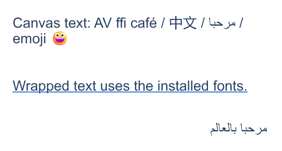
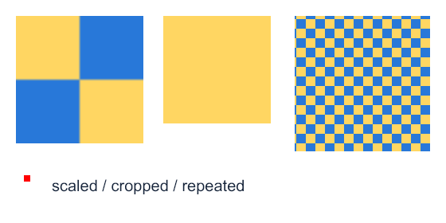
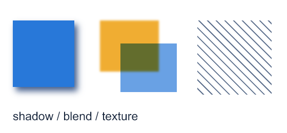
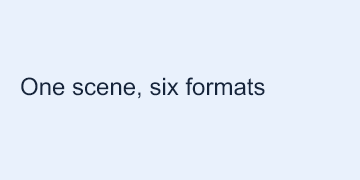
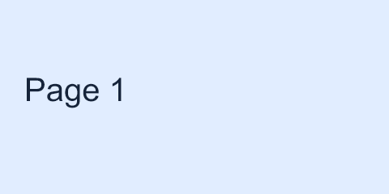
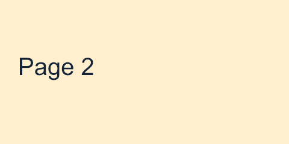
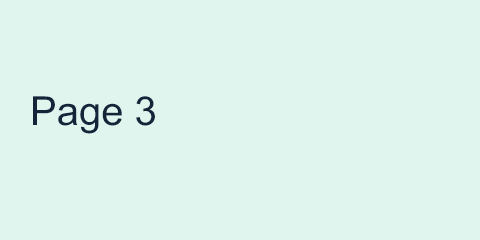
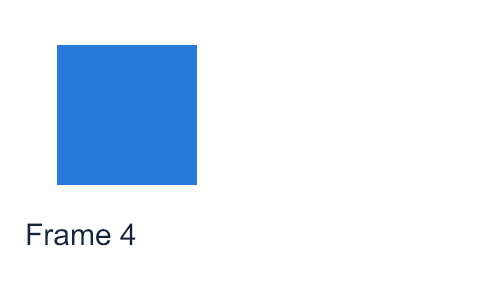

# Demos and task recipes

[中文](DEMOS.md) | English

Complete runnable program: [examples/ai_demos.py](../../../examples/ai_demos.py). It depends only on the Python standard library and published `py-skia-canvas==0.1.0a18`. Input images are generated by Canvas; the demos make no external network requests and bundle no fonts.

## Running the demos

Run from the repository root. Use a new directory for `--out`:

```shell
python examples/ai_demos.py hello --out test-runs/my-hello-001
python examples/ai_demos.py all --out test-runs/my-gallery-001
python examples/ai_demos.py all --backend cpu --out test-runs/my-cpu-001
python examples/ai_demos.py all --backend gpu --out test-runs/my-gpu-001
python examples/ai_demos.py window --out test-runs/my-window-001
```

The default `auto` preserves library selection. `cpu` uses the public setter; `gpu` requires the actual engine to report GPU and fails otherwise. `all` runs nine offscreen demos. Enable the window separately or with `--include-window`. `window --hidden` verifies a hidden window but still requires GPU/desktop support. Requesting a CPU window raises an error.

`--font-file /absolute/path/to/font.ttf` registers a legally available user-supplied font on the current thread; `text` uses the `DemoFace` alias. The font file is not copied into output.

## Demo index

| Command | APIs demonstrated | Outputs and checks |
| --- | --- | --- |
| `hello` | Canvas, fillRect, fillText, getImageData | 360×180 `preview.png`; exact RGBA assertion inside the blue rectangle |
| `paths` | Path2D, difference, gradient, DOMMatrix, save/restore | Ring, transformed triangle, rotated rectangle; explicit evenodd fill, containment and center-background assertions |
| `text` | font, measureText, textWrap, direction, textDecoration | Multilingual PNG and width/ascent/descent/line count; depends on system fonts |
| `images` | await loadImage, three drawImage forms, pattern, ImageData | Scale, crop, repeat, raw red pixels; exact RGBA readback |
| `effects` | shadow, filter, multiply, globalAlpha, texture | Shadow/compositing/hatching; scoped state with save/restore |
| `exports` | Six toBufferSync formats, density, toURLSync | PNG/JPG/WebP/raw/PDF/SVG, 720×360 2× PNG, data URL prefix |
| `pages` | newPage, pages, page, sequences | Three-page `pages.pdf`, `page-01.png` and others, first/last PNG |
| `async` | toBuffer, asyncio.gather, await toFile | Before/after snapshot PNGs and PDF; snapshots must differ |
| `batch` | Create/draw/encode inside each worker | Three PNGs; only bytes and copied engine data cross threads |
| `window` | Window, draw events, App.launch, close | Closes automatically after a few frames; saves the final frame |

Each demo writes `result.json`: version, requested backend, actual engines, file sizes/hashes, PNG dimensions, and demo-specific observations. Top-level `summary.json` records the selected demos. An existing output directory is rejected to preserve earlier results.

## Actual output gallery

These PNGs are copied directly from **0.1.0a18 Windows Vulkan GPU** demo outputs without repainting or postprocessing. See the [validation record](../VALIDATION.en.md) for Linux and GPU/CPU execution scope. System fonts can change text appearance. Images live in repository [assets](../assets/README.en.md), independent of local test directories; [manifest.json](../assets/manifest.json) records dimensions, hashes, and original output locations.

### hello: the first image

```shell
python examples/ai_demos.py hello --out test-runs/NEW_HELLO
```

360×180: explicit white background, blue rectangle, text, and an exact interior-pixel assertion.


### paths: Boolean paths, gradients, and transforms

```shell
python examples/ai_demos.py paths --out test-runs/NEW_PATHS
```

520×280: difference plus explicit `evenodd` filling leaves the ring's center clear. The triangle uses degree-based DOMMatrix rotation; the outlined rectangle uses radian-based Context rotation.


### text: measurement, wrapping, and languages

```shell
python examples/ai_demos.py text --out test-runs/NEW_TEXT
```

560×300: combining characters, Chinese, Arabic, emoji, underline, and RTL alignment. This is actual output with the platform's system fonts. Use `--font-file` to demonstrate explicit registration.



### images: scaling, cropping, repeating, and pixels

```shell
python examples/ai_demos.py images --out test-runs/NEW_IMAGES
```

560×280: a generated/reloaded checkerboard on the left, a crop in the middle, a pattern on the right, and an ImageData red pixel block below.



### effects: shadow, filter, compositing, and hatching

```shell
python examples/ai_demos.py effects --out test-runs/NEW_EFFECTS
```

560×260: a shadow, blur and multiply compositing, and a procedural texture.



### exports: one scene in several formats

```shell
python examples/ai_demos.py exports --out test-runs/NEW_EXPORTS
```

The embedded `scene.png` is 360×180. The same directory also contains JPG/WebP/raw/PDF/SVG and a 720×360 2× PNG. A Markdown preview does not verify PDF/SVG contents; demos and release tests inspect the corresponding artifacts separately.



### pages: three-page document

```shell
python examples/ai_demos.py pages --out test-runs/NEW_PAGES
```

One Canvas has three 480×240 pages and produces one three-page PDF, a PNG sequence, and explicitly selected first/last PNGs.

| Page 1 | Page 2 | Page 3 |
| --- | --- | --- |
|  |  |  |

### async: call-time snapshots

```shell
python examples/ai_demos.py async --out test-runs/NEW_ASYNC
```

These 240×120 PNGs come from tasks started before and after modifying the same Canvas. Even when awaited together, the first task retains its red snapshot and the second its green snapshot.

| Export started before the change | Export started after the change |
| --- | --- |
|  |  |

### batch: independent rendering inside each worker

```shell
python examples/ai_demos.py batch --out test-runs/NEW_BATCH
```

Two workers complete three jobs. Each creates its own Canvas, draws, and obtains PNG bytes. Jobs return only bytes and engine data.

| Job 1 | Job 2 | Job 3 |
| --- | --- | --- |
|  |  |  |

### window: final GPU-window frame

```shell
python examples/ai_demos.py window --out test-runs/NEW_WINDOW
```

A 480×300 Canvas frame, drawn and saved through a real window event loop. The image excludes OS window borders. The demo closes after a few frames; automation can add `--hidden`, which still requires GPU/desktop support.



## Recipes for AI-generated applications

### Cards and charts

Choose dimensions and fonts, create Canvas/Context, organize shapes with paths/rectangles, measure titles for positioning, and export. Combine `hello`, `paths`, and `text`. Applications convert chart data into coordinates; the library has no PPT/chart business model.

### User images

Load `image = await loadImage(path)` inside `async def`, calculate a destination from `image.width/height`, and use the five-argument scale or nine-argument crop form. Separate encoded-photo decoding from raw pixel processing, as in `images`. Applications should bound large image sizes and concurrency.

### Batch reports

Create one Canvas per task. Use `newPage()` for documents, then export a single PDF or explicit PNG sequence. Apply the documented explicit serial setting for Windows vector file sequences. See `pages`, `exports`, and `batch`.

### Web/API image responses

Draw on the request's owner thread, obtain bytes, then give them to the framework response. Async exports can be awaited in the same event loop. Do not hand an existing Canvas to another framework thread. Use the actual MIME, such as `image/png`. Framework integration belongs to the application; these demos require no web framework.

### Interactive windows

Use `Window.ctx`. Draw callbacks run on the main thread and reapply required state each frame. Adjust the demo's closing condition for sustained animation. Use offscreen jobs without desktop/GPU support; window failure is not a passed window test.

## Demo execution versus compatibility acceptance

Demos validate public API combinations and output assertions. They do not certify all upstream contracts or all driver paths. AI modifying the library should follow the [development testing workflow](../development/TESTING_AND_RELEASE.en.md): pinned Node A, matching fonts/backend, exact differences, and actual native observations.
