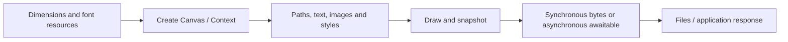

# Usage guide: build Canvas applications with the published package

[中文](README.md) | English

For `py-skia-canvas==0.1.0a18`. This guide is intended for AI that generates code, renders files, and diagnoses outputs, and for people running the examples directly.

## 1. Capabilities and runtime requirements

| Area | Capabilities |
| --- | --- |
| 2D drawing | Paths, curves, fills/strokes, clipping, transforms, gradients, patterns, textures, shadows/filters/compositing |
| Text | System/registered fonts, shaping, RTL, measurement, wrapping, decoration, outlines |
| Images | Encoded image loading, crop/scale, drawing between canvases, ImageData and pixel access |
| Output | PNG, JPG, WebP, raw, PDF, SVG; sync/async, density, pages, file sequences |
| Desktop | App/Window, drawing callbacks and input events; requires GPU and desktop support |

Initial accepted wheels support **CPython 3.13, Windows AMD64, and Linux glibc 2.28+ x86_64**. macOS, ARM, musl, and other Python ABIs have no accepted wheel for this version. Platform features retained in source do not imply that matching release wheels exist.

Canvas exposes the shared Rust/Skia core to Python. The library handles drawing, text shaping/layout, and encoding; applications organize scenes, supply resources, choose outputs, and handle errors.

## 2. Install and confirm the version

```shell
python -m pip install --only-binary=:all: py-skia-canvas==0.1.0a18
python -c "import py_skia_canvas as c; print(c.__version__, c.__file__)"
```

Use a fresh virtual environment. On Windows, choose a short path such as `C:\venvs\canvas`; deeply nested paths can exceed `MAX_PATH` for license files if system long-path support is disabled. Using a wheel requires no Node, npm, MSVC, Rust, or skia-python installation.

Offscreen rendering can run without a Vulkan runtime library or usable GPU; the original core automatically falls back to CPU. GPU rendering requires driver support, and GUI requires an accessible desktop. Fonts come from the system or explicit registration; wheels do not bundle system fonts.

## 3. Minimal complete program

Save as `hello.py` and run `python hello.py`:

```python
from pathlib import Path
from py_skia_canvas import Canvas

canvas = Canvas(360, 180)
ctx = canvas.getContext("2d")
ctx.fillStyle = "white"
ctx.fillRect(0, 0, 360, 180)
ctx.fillStyle = "#2878d9"
ctx.fillRect(20, 20, 320, 80)
ctx.font = "24px sans-serif"
ctx.fillStyle = "#16243a"
ctx.fillText("Hello Canvas", 20, 145)
Path("hello.png").write_bytes(canvas.toBufferSync("png"))
print(canvas.engine)
```

This produces a 360×180 PNG. Canvas starts transparent; the example explicitly paints white. The y coordinate of `fillText` is a text baseline position. Keep a strong `canvas` reference until drawing/export calls finish: a Context's `.canvas` access uses a weak parent reference.


More actual outputs appear in the [gallery](DEMOS.en.md#actual-output-gallery). Images were generated with the published package; provenance and hashes are in the [image manifest](../assets/manifest.json).

## 4. Recommended workflow

1. Decide logical dimensions, format, pages, fonts, and whether a window is required.
2. Install the pinned version; record OS, architecture, and `canvas.engine`.
3. Prepare Canvas, fonts, paths, and images on their creating thread. Await image loading before drawing.
4. Scope local styles/transforms with `save()` / `restore()`; set each drawing component's required state explicitly.
5. Export synchronously, or start an async export on the owner thread and await its result.
6. Check file signatures, dimensions, page counts, actual pixels, and required text. Propagate export failure as failure.
7. Return file paths, format/dimensions, actual backend, and resource limitations.



## 5. Coordinates, colors, and transforms

- The origin is at the top left; x increases rightward and y downward. Paths, text, and line widths use canvas units. In ordinary 1× raster output, one unit corresponds to one output pixel.
- Canvas and exports support fractional geometry. Do not round early or add pixel/color compensation.
- `ctx.rotate()`, arc/ellipse, conic gradients, and texture angles use radians. `DOMMatrix.rotate()` uses degrees. CSS transform strings carry units such as `deg`.
- Assign CSS colors to `fillStyle` / `strokeStyle`; gradients, patterns, and textures can also serve as styles.
- `density=2` doubles raster output width and height. It is not an automatically inferred browser devicePixelRatio.
- `clearRect` clears a region. Changing Canvas dimensions resets the current page; determine dimensions before drawing to avoid accidental resets.

See [demos](DEMOS.en.md) for transforms/state and the [API reference](API_REFERENCE.en.md) for common names.

## 6. Fonts and text

Set `ctx.font` before measuring or drawing. Use CSS font strings such as `28px sans-serif` or `italic 700 24px serif`. `measureText(text, maxWidth)` returns TextMetrics; entries in `lines` are Python dicts, so access keys rather than JavaScript-style `line.x` attributes.

To pin a specific font, register a legally available, readable file in the same drawing worker:

```python
from py_skia_canvas import FontLibrary

FontLibrary.use("ReportFace", "/absolute/path/to/font.ttf")
assert FontLibrary.has("ReportFace")
# Then use on this thread's ctx: ctx.font = '28px "ReportFace"'
```

Replace the placeholder path. FontLibrary is a singleton facade, but registration/reset applies to the calling thread's font library. Each thread-pool worker registers its required fonts. `has()` checks a family name; it does not establish glyph coverage. Inspect actual CJK/emoji/RTL output for missing glyphs and wrapping.

Use `textWrap=True` with `fillText(text, x, y, maxWidth)` and measure with the same text/font/width. Text offsets follow upstream UTF-16 code units and are not directly usable as Python Unicode slice indexes. Pass full strings to the library rather than replacing shaping with per-character positioning.

## 7. Images and pixels

`await loadImage(src)` loads and decodes PNG/JPG/WebP/SVG and other supported inputs. Sources can be encoded bytes, local paths, data URLs, or HTTP URLs. Applications handle URL selection, timeouts, errors, and input size limits. Offline work can use files or bytes directly.

Common positional forms of `drawImage`:

```text
drawImage(image, dx, dy)
drawImage(image, dx, dy, dw, dh)
drawImage(image, sx, sy, sw, sh, dx, dy, dw, dh)
```

Source regions use image pixels; destination regions use canvas coordinates. `ImageData(width, height)` creates writable pixels; `ImageData(bytes, width, height)` accepts raw data. Default `rgba/srgb` uses four bytes per pixel. `putImageData` writes pixels directly; `getImageData` returns pixel data with its own storage.

**`loadImageData` consumes raw pixels; it is not a PNG decoder.** Use `loadImage` for encoded images, then `ImageData(image)` or draw and read pixels back. The `images` demo provides a runnable workflow.

## 8. Exports, pages, and async work

| Need | Preferred entry point | Result |
| --- | --- | --- |
| Obtain encoded bytes immediately | `canvas.toBufferSync("png", opts)` | `bytes` |
| Await encoded bytes | `await canvas.toBuffer("png", opts)` | `bytes` |
| Write a file immediately | `canvas.toFileSync(path, opts)` | `None` |
| Write a file asynchronously | `await canvas.toFile(path, opts)` | `None` |
| Base64 data URL | `toURLSync` / `await toURL` | `str` |
| Multipage document | Export PDF after `newPage()` | PDF includes selected pages |
| Multiple raster pages | `toFileSync("page-{2}.png")` | Per-page files with two-digit zero padding |

File format can be inferred from the extension; give buffer exports an explicit format. Common options: `quality` 0–1 (default 0.92), positive integer `density` (default 1), CSS background `matte`, PDF/SVG text `outline`, and **1-based** `page`; negative values count from the last page. Export pages do not use Python's 0-based indexing.

`canvas.pages` returns Contexts in creation order. `newPage()` returns the new current Context; later `getContext("2d")` returns that latest page. PDF exports include multiple pages by default; other single-file formats default to the latest page. Select `page` explicitly when needed.

Async exports start/materialize their snapshot when the export method is called. Later Canvas changes do not change an earlier unawaited task's picture. ExportPromise is an awaitable; normally await it inside `async def main()` and call `asyncio.run(main())`. Do not assume every awaitable can be passed directly to `asyncio.run`.

On Windows, default concurrent PDF/SVG **file sequences** inherit nondeterministic glyph/font-subset loss. For stable vector sequences, set `RAYON_NUM_THREADS=1` before starting the process, or choose a single multipage PDF as covered by acceptance. This is an explicit deployment choice; the library's concurrency defaults remain unchanged.

## 9. CPU, parallel tasks, and windows

Start normal applications with `Canvas(w, h)`, allowing the original GPU selection/CPU fallback. To request CPU explicitly, set `canvas.gpu = False` after construction and before drawing. **Constructor options `{"gpu": False}` are not a reliable CPU switch under 3.0.8 compatibility behavior.** The setter does not mean the process never probes GPU availability.

Canvas/Context/Path2D/Image/Gradient/Pattern/Texture belong to their creating thread. For thread-pool work, create, draw, and synchronously export inside each worker; return bytes and plain data. Do not pass an existing Canvas to `asyncio.to_thread` or another drawing thread. DOM values and already obtained bytes/pixel storage contain no GPU context.

Create windows on the main thread, draw through `win.on("draw", callback)`, and start with `asyncio.run(App.launch())`. This backend requires GPU/desktop support. GPU-less services should use offscreen Canvas. The `window` demo closes automatically so the process can exit.

## 10. Before delivery

Confirm the installed version, output existence/dimensions, actual font rendering, format/page selection, and actual backend. Preserve errors when execution fails; do not return a blank image or empty file as success. See [troubleshooting](TROUBLESHOOTING.en.md).
