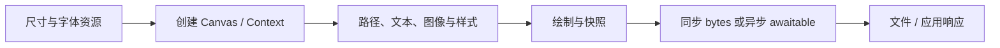

# 使用指南：用发布包构建 Canvas 应用

适用版本：`py-skia-canvas==0.1.0a18`。本指南面向生成代码、执行渲染和诊断输出的 AI，也适合直接复制示例的人类使用者。

## 1. 能力与运行条件

| 范围 | 能力 |
| --- | --- |
| 2D 绘制 | 路径、曲线、填充/描边、clip、变换、渐变、pattern、texture、阴影/滤镜/混色 |
| 文本 | 系统/注册字体、shaping、RTL、文本测量、换行、装饰、文字轮廓 |
| 图像 | 编码图像加载、裁剪/缩放、Canvas 互绘、ImageData 和像素读写 |
| 输出 | PNG、JPG、WebP、raw、PDF、SVG，同步/异步、density、多页、文件序列 |
| 桌面 | App/Window、绘制回调和输入事件，要求 GPU 与桌面环境 |

首发 wheel 支持 **CPython 3.13、Windows AMD64、Linux glibc 2.28+ x86_64**。macOS、ARM、musl 和其他 Python ABI 未获得本版本 wheel 验收。不要将 source 中保留的其他平台 feature 理解为已经发布对应 wheel。

Canvas 是共享 Rust/Skia 核心的 Python 接口。绘图、字体排版和编码由库完成；应用负责组织场景、提供资源、选择输出和处理错误。

## 2. 安装与确认版本

```shell
python -m pip install --only-binary=:all: py-skia-canvas==0.1.0a18
python -c "import py_skia_canvas as c; print(c.__version__, c.__file__)"
```

推荐新建虚拟环境。Windows 可使用较短路径，例如 `C:\venvs\canvas`；未启用系统长路径支持时，过深路径可能使许可文件超过 `MAX_PATH`。使用 wheel 不需要安装 Node、npm、MSVC、Rust 或 skia-python。

离屏绘制允许没有 Vulkan 运行库或可用 GPU；原核心会自动回退 CPU。GPU 绘制需要本机驱动支持；GUI 还需要可访问的桌面。字体由系统或显式注册提供，wheel 不携带系统字体。

## 3. 最小完整程序

保存为 `hello.py`，执行 `python hello.py`：

```python
from pathlib import Path
from py_skia_canvas import Canvas

canvas = Canvas(360, 180)
ctx = canvas.getContext("2d")
ctx.fillStyle = "white"
ctx.fillRect(0, 0, 360, 180)
ctx.fillStyle = "#2878d9"
ctx.fillRect(20, 20, 320, 80)
ctx.font = "24px sans-serif"
ctx.fillStyle = "#16243a"
ctx.fillText("Hello Canvas", 20, 145)
Path("hello.png").write_bytes(canvas.toBufferSync("png"))
print(canvas.engine)
```

结果是 360×180 PNG；画布初始透明，上例显式画白色背景。`fillText` 的 y 是文本基线位置。保留 `canvas` 引用直到绘制/导出调用完成，Context 的 `.canvas` 为弱父对象访问。


更多实际输出见[示例图册](DEMOS.md#实际输出图册)。图像由本库发布版生成，来源和 SHA 见[图片清单](../assets/manifest.json)。

## 4. 推荐工作流程

1. 明确逻辑尺寸、输出格式、是否多页、字体和是否需要窗口。
2. 安装固定版本，记录操作系统、架构及 `canvas.engine`。
3. 在创建线程准备 Canvas、字体、路径与图片；图片加载先 `await` 完成。
4. 用 `save()` / `restore()` 限定局部样式和变换；每个功能片段设置自己需要的状态。
5. 调用同步导出，或在 owner 线程启动异步导出并等待结果。
6. 检查文件签名、尺寸、页数、实际像素及所需文字；输出失败应传播为失败。
7. 向使用者返回文件路径、格式/尺寸、实际 backend 和资源限制。



## 5. 坐标、颜色与变换

- 画布原点在左上，x 向右、y 向下；路径/文本/线宽使用 canvas units。常规 1× raster 下一个单位对应一个输出像素。
- Canvas 与导出支持小数几何；应用不要提前取整或对颜色、坐标做“像素修正”。
- `ctx.rotate()`、arc/ellipse、conic gradient 和 texture angle 使用弧度；`DOMMatrix.rotate()` 使用角度。CSS transform 字符串带 `deg` 等单位。
- CSS 颜色赋给 `fillStyle` / `strokeStyle`，渐变、pattern、texture 也可作为样式。
- `density=2` 将输出 raster 的物理尺寸扩大 2 倍；它不是自动设置的浏览器 devicePixelRatio。
- `clearRect` 用于清除区域。改变 Canvas 宽高会重置当前页；预先确定尺寸，避免在绘制完成后无意触发重置。

变换与状态配方见 [DEMOS](DEMOS.md)，全部常用名称见 [API_REFERENCE](API_REFERENCE.md)。

## 6. 字体与文本

先设置 `ctx.font` 再测量和绘制。使用 CSS 字体字符串，例如 `28px sans-serif`、`italic 700 24px serif`。`measureText(text, maxWidth)` 返回 `TextMetrics`；`lines` 的条目是 Python dict，不能用 JS 的 `line.x` 属性语法访问。

需要固定指定字体时，在同一工作线程注册合法可读的字体文件：

```python
from py_skia_canvas import FontLibrary

FontLibrary.use("ReportFace", "/absolute/path/to/font.ttf")
assert FontLibrary.has("ReportFace")
# 接着在该线程的 ctx 上使用：ctx.font = '28px "ReportFace"'
```

路径须由调用者替换。`FontLibrary` 是单例入口，注册与 reset 作用于调用线程的字体库。线程池里的每个 worker 应自行注册所需字体。`has()` 查询 family 名，不证明所有字符都有 glyph。中文、emoji、RTL 仍应对实际输出检查缺字与换行。

`textWrap=True` 配合 `fillText(text, x, y, maxWidth)`；测量使用相同 text/font/width。文本索引遵循上游 UTF-16 code units，不能直接当作 Python Unicode 字符切片下标。使用完整字符串交给库排版，避免自行逐字布局替代 shaping。

## 7. 图像与像素

`await loadImage(src)` 加载并解码 PNG/JPG/WebP/SVG 等输入，src 可为编码 bytes、本地路径、data URL 或 HTTP URL。业务代码处理网络地址、超时、异常和输入大小；离线工作可直接使用本地文件或 bytes。

`drawImage` 有三组常用位置参数：

```text
drawImage(image, dx, dy)
drawImage(image, dx, dy, dw, dh)
drawImage(image, sx, sy, sw, sh, dx, dy, dw, dh)
```

源区域使用图像像素，目标区域使用画布坐标。`ImageData(width, height)` 创建可写像素；`ImageData(bytes, width, height)` 接收 raw 数据；默认 `rgba/srgb` 为四字节每像素。`putImageData` 直接写像素，`getImageData` 读取拥有自身存储的像素结果。

**`loadImageData` 接收 raw 像素，不是编码 PNG 的解码入口。** 编码图像走 `loadImage`，然后可用 `ImageData(image)` 或绘制后读取像素。可运行流程见 `images` 示例。

## 8. 输出、多页与异步

| 需求 | 首选入口 | 结果 |
| --- | --- | --- |
| 立即取得编码字节 | `canvas.toBufferSync("png", opts)` | `bytes` |
| 等待编码字节 | `await canvas.toBuffer("png", opts)` | `bytes` |
| 立即写文件 | `canvas.toFileSync(path, opts)` | `None` |
| 异步写文件 | `await canvas.toFile(path, opts)` | `None` |
| base64 data URL | `toURLSync` / `await toURL` | `str` |
| 多页文档 | `newPage()` 后导出 PDF | PDF 包含选定页 |
| 多个栅格页面 | `toFileSync("page-{2}.png")` | 按页生成带两位补零的文件 |

文件格式可由扩展名推导；Buffer 用显式格式名。常用 options：`quality` 为 0–1（默认 0.92），`density` 为正整数（默认 1），`matte` 为 CSS 底色，`outline` 为 PDF/SVG 文字轮廓选项，`page` 为 **1-based**，负数从末页计数。不把导出 `page` 当 Python 的 0-based 索引。

`canvas.pages` 是按创建顺序返回的 Context 列表；`newPage()` 返回新页 Context，后续 `getContext("2d")` 取得最新页。默认 PDF 导出多页；默认非 PDF 单文件输出最新页。显式 `page` 可消除歧义。

异步导出是在调用入口时启动/形成快照。之后修改 Canvas 不会把尚未 await 的旧结果变成新画面。`ExportPromise` 是 awaitable；一般用 `async def main(): ... await ...` 后 `asyncio.run(main())`，不要假定每个 awaitable 都能直接传给 `asyncio.run`。

Windows 原默认并发 PDF/SVG **文件序列**有继承的非确定性漏字/字体子集问题。需要稳定矢量序列时，在启动进程前设置 `RAYON_NUM_THREADS=1`，或按已验收策略选择单个多页 PDF。该设置是显式部署选择，库默认并发没有改变。

## 9. CPU、并行和窗口

正常应用从 `Canvas(w, h)` 开始，允许原策略选择 GPU 或回退 CPU。若明确需要 CPU，在创建后、绘制前设置 `canvas.gpu = False`。**构造 options 中的 `{"gpu": False}` 在 3.0.8 兼容行为下不能作为可靠的 CPU 开关。** 手动 setter 也不表示整个进程从未进行 GPU 可用性探测。

Canvas/Context/Path2D/Image/Gradient/Pattern/Texture 均按创建线程使用。用线程池并行时，每个 worker 从创建 Canvas 到同步导出都在该 worker 内完成，返回 bytes 和普通数据。不要把已有 Canvas 交给 `asyncio.to_thread` 或另一个线程绘制。纯 Python DOM 值和已经取得的 bytes/像素数据不携带 GPU context。

窗口在主线程创建，通过 `win.on("draw", callback)` 绘制，使用 `asyncio.run(App.launch())` 启动。该后端需要 GPU/桌面；无 GPU 的服务任务采用离屏 Canvas。`window` 示例会自动关闭，避免进程常驻。

## 10. 交付前核对

确认使用已安装的正确版本、输出存在且尺寸正确、所需字体实际显示、格式和页码符合需求、记录实际 backend。运行失败时保留错误，不创建白图或空文件充当成功。具体排错见 [TROUBLESHOOTING](TROUBLESHOOTING.md)。
